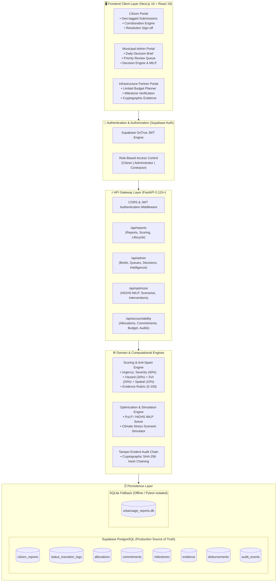
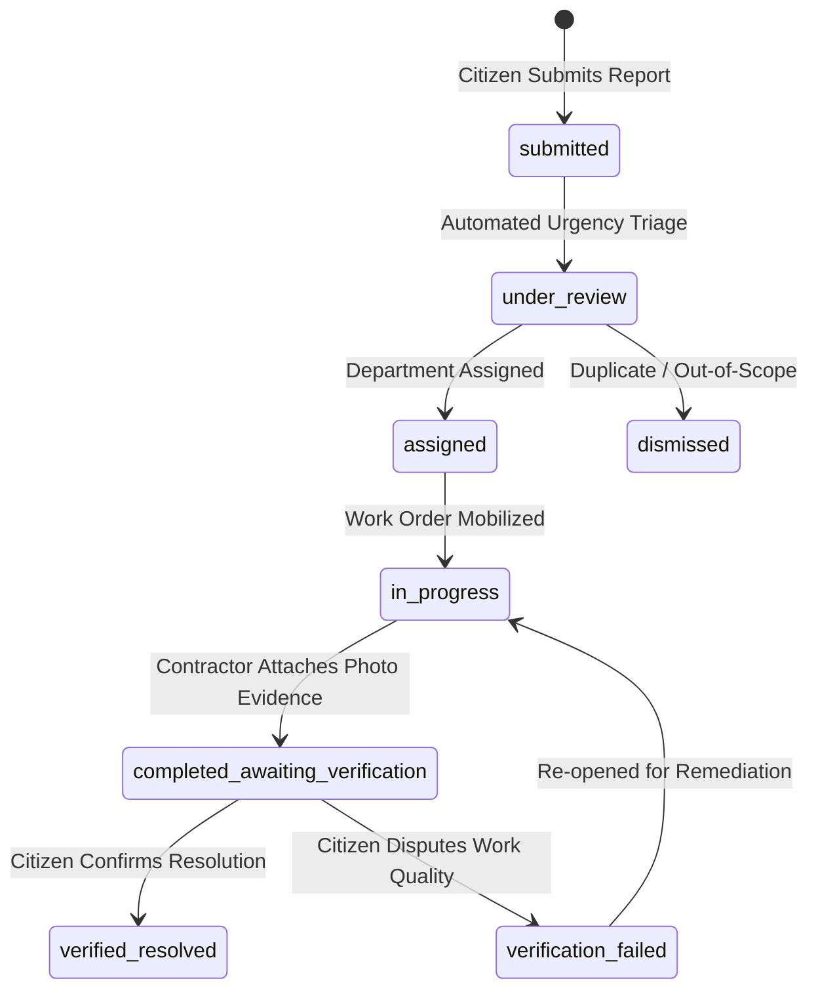

<div align="center">

# 🌿 UrbanSage AI
### *Intelligent Decisions for Sustainable Cities*

[-059669?style=for-the-badge&logo=next.js&logoColor=white)](https://nextjs.org/)
[](https://fastapi.tiangolo.com/)
[](https://python.org)
[](https://supabase.com)
[](https://www.typescriptlang.org/)
[-0d9488?style=for-the-badge)](frontend/src/lib/i18n.tsx)
[](LICENSE)

<br/>

**A closed-loop urban sustainability governance platform connecting citizen environmental intelligence, mathematical resource optimization (PuLP/HiGHS MILP), municipal administrative decision-making, and cryptographic financial accountability.**

[Explore Portals](#-portal-workflows--capabilities) • [System Architecture](#-system-architecture) • [Getting Started](#-installation--local-setup) • [API Documentation](#-verified-api-endpoints) • [Scientific Notice](#-scientific-notice--data-provenance)

</div>

---

> [!IMPORTANT]
> ### 🔬 Scientific Notice & Data Provenance Segregation
> 1. **Synthetic Baseline Telemetry:** Ward-level baseline vulnerability indices (flooding, urban heat islands, water scarcity, green cover deficit), social vulnerability indices (SVI), and cost-effectiveness benchmarks utilized in this platform are **calibrated synthetic datasets** generated for algorithmic testing and decision-support simulation. They do **not** represent live uncalibrated sensor feeds or empirical physical telemetry.
> 2. **Citizen Observations:** Citizen submissions are crowd-sourced observational claims (`data_source: CITIZEN_REPORT`, `is_verified_measurement: False`). In accordance with municipal auditing standards, citizen claims are strictly quarantined and distinct from municipal ground truth until formal administrative triage and field engineering verification sign-off.

---

## 📑 Table of Contents

- [Urban Governance Problem](#-the-urban-governance-problem)
- [The UrbanSage Solution](#-the-urbansage-solution)
- [Key Features](#-key-features)
- [System Architecture](#-system-architecture)
- [Portal Workflows & Capabilities](#-portal-workflows--capabilities)
  - [1. Citizen Environmental Portal](#1-citizen-environmental-portal)
  - [2. Municipal Administrator Intelligence](#2-municipal-administrator-intelligence)
  - [3. Infrastructure Partner Portal & Budget Planner](#3-infrastructure-partner-portal--limited-budget-planner)
- [Budget Planning & Financial Accountability](#-budget-planning--financial-accountability)
- [Bilingual Support (English & ಕನ್ನಡ)](#-bilingual-support-english--ಕನ್ನಡ)
- [Technology Stack](#-technology-stack)
- [Project Structure](#-project-structure)
- [Installation & Local Setup](#-installation--local-setup)
- [Environment Configuration](#-environment-configuration)
- [Verified API Endpoints](#-verified-api-endpoints)
- [Authentication & Role-Based Security](#-authentication--role-based-security)
- [Interface Previews & Screenshots](#-interface-previews--screenshots)
- [Implementation Status & Roadmap](#-implementation-status--roadmap)
- [Contributing & License](#-contributing--license)

---

## 🏙️ The UrbanGovernance Problem

Rapidly urbanizing global cities like Bengaluru face compounded climate shocks: **flash flooding**, **urban heat islands**, **water distress**, and **rapid loss of urban green canopies**. 

Traditional municipal administration suffers from five systemic disconnects:
1. **Disconnected Civic Grievances:** Citizens report flooding or dry taps into opaque complaint portals with zero visibility into prioritization criteria or resolution status.
2. **Ad-Hoc, Unweighted Decision Making:** Municipal dispatchers lack objective urgency scoring, resulting in squeaky-wheel resource allocation rather than risk-weighted deployment.
3. **Unoptimized Capital Allocation:** Sustainability budgets are distributed evenly or politically rather than mathematically maximizing risk reduction subject to physical land and social equity constraints.
4. **Opaque Contractor Execution & "Ghost" Completions:** Contractors can unilaterally mark civic repairs "resolved" without cryptographic proof, site inspections, or citizen re-verification.
5. **Language & Civic Exclusion:** Portals built exclusively in English disenfranchise local vernacular communities from civic participation.

---

## 💡 The UrbanSage Solution

UrbanSage AI closes the governance loop by enforcing a **single source of truth** across three dedicated stakeholder portals powered by **FastAPI**, **Next.js 16 (Turbopack)**, and **Supabase PostgreSQL**:

```text
 ┌───────────────────────┐
 │   Citizen Reporter    │ ── Submits geo-referenced issue (photos, severity, GPS)
 └──────────┬────────────┘
            │  Urgency Score (0-100) & Evidence Confidence Rubric
            ▼
 ┌───────────────────────┐
 │ Municipal Admin Brief │ ── Triages Priority Queue, inspects recommendations, records decisions
 └──────────┬────────────┘
            │  PuLP/HiGHS Mixed-Integer Linear Programming (MILP) Optimizer
            ▼
 ┌───────────────────────┐
 │ Capital Budget Ledger │ ── Authorizes capital allocation & vendor commitments
 └──────────┬────────────┘
            │  Milestone progress + Tamper-evident SHA-256 evidence hashes
            ▼
 ┌───────────────────────┐
 │Infrastructure Partner │ ── Submits expenditure proposals against capped available budgets
 └──────────┬────────────┘
            │  Independent inspection sign-off & citizen dispute power
            ▼
 ┌───────────────────────┐
 │ Verified Resolution   │ ── Citizen signs off or re-opens dispute back to municipal queue
 └───────────────────────┘
```

---

## ✨ Key Features

### 1. Citizen Environmental Problem Reporting
- **Multi-Hazard Coverage:** Structured reporting for **Flooding & Drainage Blocks**, **Water Scarcity & Supply**, **Urban Heat & Lack of Shade**, and **Loss of Green Cover**.
- **Transparent Scoring Engine:**
  - **Urgency Score ($0.0 - 100.0$):** Weighted linear combination of citizen severity ($40\%$), acute hazard weight ($30\%$), ward vulnerability index ($20\%$), and spatio-temporal corroboration ($10\%$).
  - **Evidence Confidence ($0.0 - 100.0$):** Rigorous completeness rubric grading narrative length, landmark specificity, GPS accuracy, contact validity, and photographic metadata.
- **Anti-Spam & Corroboration Engine:** Spatio-temporal windowing rejects duplicate bursts from identical reporters while rewarding independent corroboration within 500m / 72 hours.
- **Privacy By Design:** Automated redaction permanently removes citizen phone numbers and private identifiers from all public views and DTOs.

### 2. Municipal Administrator Intelligence & Action Radar
- **Daily Decision Brief (`GET /api/admin/decision-brief`):** Executive overview aggregating critical urgency incidents ($>70$), overdue active tickets ($>48\text{h}$), pending reviews, and failed verification disputes.
- **Priority Review Queue (`GET /api/admin/priority-queue`):** Server-side paginated and filterable queue with stable multi-attribute sorting (`urgency_desc`, `urgency_asc`, `age_desc`, `age_asc`).
- **Departmental Recommendation Engine:** Rule-based decision assistant that maps hazard characteristics to responsible civic agencies (Stormwater Drainage, Water Supply, Forest & Ecology, Solid Waste Management) with audit justifications.
- **Administrative Decision Recording:** Persistent record of council resolution references, allocated priority tiers, and departmental assignments stored directly in Supabase PostgreSQL.

### 3. Mathematical Optimization Cockpit (PuLP / HiGHS MILP)
- **Objective Function:** Minimizes citywide composite environmental risk across four hazard dimensions simultaneously.
- **Hard Constraint Enforcement:**
  - **Budget Cap:** $\sum c_i x_{i,j} \le B$ (enforces strict municipal fiscal ceilings).
  - **Physical Land Limits:** Space caps for bioswales, Miyawaki urban forests, permeable pavements, and rooftop rainwater harvesting.
  - **Intervention Capacity:** Maximum implementable infrastructure units per ward.
  - **Diversity Protection:** Prevents single-category over-allocation.
  - **Social Equity Protection:** Enforces minimum budget quotas for high Social Vulnerability Index ($\text{SVI} \ge 60$) wards.

### 4. Climate Stress Scenario Simulator
- **Deterministic Multi-Hazard Stress Testing:**
  - **Baseline:** Standard municipal conditions.
  - **Extreme Monsoon:** $1.5\times$ flood risk shock with mathematical clamping to $[0, 100]$.
  - **Severe Heatwave / Drought:** $1.4\times$ water scarcity and thermal stress shock.
  - **Fiscal Shock:** $30\%$ budget cut evaluating pruned projects and marginal risk spikes.

### 5. Infrastructure Partner Portal & Limited Budget Planner
- **Four Financial Summary Cards:** Total Allocated Budget, Committed Amount, Amount Spent / Disbursed, and Remaining Available Budget.
- **Budget Allocation Proposal Form:** Real-time cap enforcement preventing proposals exceeding remaining balance.
- **Proposals Audit Table:** Live list of submitted expenditure proposals with real-time municipal review statuses.
- **Milestone Verification Gateway:** Physical progress logging, photographic evidence uploads, and tamper-evident **SHA-256 hash chains** linked to the municipal audit ledger.

### 6. Full Bilingual Localization (English & ಕನ್ನಡ)
- Native bilingual support throughout the platform toggled via an interactive navbar switch.
- Complete dictionary coverage spanning navigation, forms, error alerts, mathematical labels, and financial tables.

---

## 🏛️ System Architecture



---

## 🔄 Portal Workflows & Capabilities

### 1. Citizen Environmental Portal
*Empowering residents with transparent civic reporting and independent sign-off power.*

- **Incident Reporting:** Citizens report waterlogging, drought distress, heat hotspots, or tree felling with geo-coordinates, photos, and descriptive context.
- **Status Lifecycle Tracker:** Live tracking across the 14-state machine:
  $$\text{Submitted} \longrightarrow \text{Under Review} \longrightarrow \text{Assigned} \longrightarrow \text{In Progress} \longrightarrow \text{Completed Awaiting Verification} \longrightarrow \text{Verified Resolved}$$
- **Independent Citizen Sign-Off Power:** When work is completed, tickets do not automatically close. Citizens review contractor completion photos and work notes to either **Confirm Resolution** or **Dispute Resolution** back to the municipal inspection queue.



---

### 2. Municipal Administrator Intelligence
*Data-driven prioritization, mathematical resource allocation, and formal governance.*

- **Action Radar Priority Queue:** Live dashboard highlighting high-urgency incidents ($>70$) and overdue tickets ($>48\text{h}$) with server-side multi-attribute sorting.
- **Departmental Decision Recording:** Evaluates automated recommendations (e.g., Stormwater Drainage for acute flooding), selects priority tiers, enters council resolution references, and saves binding administrative orders.
- **HiGHS MILP Optimizer Cockpit:** Interactive interface allowing administrators to adjust budget ceilings, set social vulnerability weights, and run mathematical solver optimizations.
- **Environmental Intelligence Analytics:** Executive charts analyzing hazard distribution across Bengaluru wards, severity breakdowns, and empirical data provenance.

---

### 3. Infrastructure Partner Portal & Limited Budget Planner
*Transparent work order execution and capped financial claims.*

- **Limited Budget Planner:**
  - **Live Balance Visibility:** Real-time visibility of contracted funds, disbursements, and uncommitted balance.
  - **Proposal Submission:** Submit expenditure claims tagged to specific contract commitments.
  - **Automated Validation:** Client and backend immediately reject proposals exceeding available balances.
- **Milestone & Evidence Gateway:** Log completion percentages and attach documentary field evidence (site photos, inspection reports, material invoices) with automated **SHA-256 cryptographic verification hashes**.
- **RBAC Governance Safeguard:** Partners can submit expenditure proposals but **cannot approve payouts or self-authorize disbursements**.

---

## 💰 Budget Planning & Financial Accountability

UrbanSage AI enforces double-entry fiscal integrity through actual persisted Supabase PostgreSQL records:

$$\mathbf{Remaining\ Budget} = \mathbf{Allocated\ Budget} - \mathbf{Committed\ Amount} - \mathbf{Disbursed\ Amount} - \mathbf{Pending\ Claims}$$

```text
┌────────────────────────────────────────────────────────────────────────────────────────┐
│                        INFRASTRUCTURE PARTNER BUDGET OVERVIEW                          │
├────────────────────┬────────────────────┬────────────────────┬─────────────────────────┤
│  Total Allocated   │  Committed Amount  │  Amount Disbursed  │    Remaining Budget     │
│     ₹35.00 L       │      ₹32.50 L      │      ₹25.00 L      │         ₹7.50 L         │
│  (Total Approved)  │ (Contracted Value) │ (Released Payouts) │  (Available Execution)  │
└────────────────────┴────────────────────┴────────────────────┴─────────────────────────┘
```

- **Zero Double-Counting:** Committed amounts encompass completed disbursements; pending claims are tracked as encumbrances against remaining balance.
- **Dual-Layer Validation:** If a partner proposes ₹10.00L against an available balance of ₹7.50L:
  - **Frontend:** Disables submission button and highlights the allowable execution limit.
  - **Backend:** `submit_expenditure_request` raises `ValueError: Proposed expenditure ₹10.00L exceeds available commitment balance ₹7.50L`, returning **HTTP 400 Bad Request**.
- **Audit Event Trail:** Every financial transition records an immutable, hash-linked audit entry in `audit_events`.

---

## 🌐 Bilingual Support (English & ಕನ್ನಡ)

UrbanSage AI is built from the ground up with native bilingual localization for Bengaluru's civic community:

| English Interface Element | ಕನ್ನಡ (Kannada) Translation | Context |
| :--- | :--- | :--- |
| **Limited Budget Planner** | **ಪರಿಮಿತ ಬಜೆಟ್ ಯೋಜಕ** | Infrastructure Partner Dashboard |
| **Total Allocated Budget** | **ಒಟ್ಟು ಹಂಚಿಕೆಯಾದ ಬಜೆಟ್** | Financial Summary Card 1 |
| **Committed Amount** | **ಬದ್ಧ ಮೊತ್ತ** | Financial Summary Card 2 |
| **Amount Spent / Disbursed** | **ವೆಚ್ಚವಾದ / ವಿತರಿಸಲಾದ ಮೊತ್ತ** | Financial Summary Card 3 |
| **Remaining Budget** | **ಉಳಿದ ಬಜೆಟ್** | Financial Summary Card 4 |
| **Save Proposal** | **ಪ್ರಸ್ತಾವನೆಯನ್ನು ಉಳಿಸಿ** | Budget Proposal Submission |
| **Existing Proposals** | **ಅಸ್ತಿತ್ವದಲ್ಲಿರುವ ವೆಚ್ಚದ ಪ್ರಸ್ತಾವನೆಗಳು** | Proposal Tracking Ledger |
| **Daily Decision Brief** | **ದೈನಂದಿನ ನಿರ್ಧಾರ ಸಂಕ್ಷಿಪ್ತ** | Municipal Administrator Dashboard |
| **Priority Review Queue** | **ಆದ್ಯತಾ ಪರಿಶೀಲನಾ ಸರತಿ** | Administrative Dispatch Queue |
| **HiGHS MILP Optimizer** | **HiGHS ಬಜೆಟ್ ಆಪ್ಟಿಮೈಜರ್** | Mathematical Optimization Engine |
| **Submit Environmental Report** | **ಪರಿಸರ ಸಮಸ್ಯೆಯನ್ನು ವರದಿ ಮಾಡಿ** | Citizen Reporting Portal |
| **Independent Citizen Sign-Off** | **ನಾಗರಿಕ ಪರಿಶೀಲನೆ ಮತ್ತು ದೃಢೀಕರಣ** | Resolution Verification Power |

---

## 🛠️ Technology Stack

```text
┌────────────────────────────────────────────────────────────────────────┐
│                              FRONTEND                                  │
│  • Framework: Next.js 16.4.2 (App Router, Turbopack)                   │
│  • Core: React 19, TypeScript 5+, HTML5, Vanilla CSS Design System     │
│  • Component Architecture: Lucide React, Glassmorphism Cards           │
│  • Localization: Context-driven bilingual engine (i18n.tsx)            │
├────────────────────────────────────────────────────────────────────────┤
│                              BACKEND                                   │
│  • Framework: FastAPI 0.115+ (Python 3.14 / 3.11+)                     │
│  • Data Validation & DTOs: Pydantic v2 (Strict Domain Schemas)         │
│  • Web Server: Uvicorn ASGI Server                                     │
│  • Mathematical Solver: PuLP 2.9+ / HiGHS Mixed-Integer Linear Solver   │
├────────────────────────────────────────────────────────────────────────┤
│                       DATABASE & AUTHENTICATION                        │
│  • Primary Database: Supabase PostgreSQL (Foreign Keys, Indexes, RLS)  │
│  • Authentication: Supabase Auth (GoTrue JWT Bearer Tokens)            │
│  • Local/Test Database: SQLite 3 with Write-Ahead Logging (WAL)        │
│  • Integrity: Cryptographic SHA-256 Hash Chaining for Audit Events     │
└────────────────────────────────────────────────────────────────────────┘
```

---

## 📁 Project Structure

```text
UrbanSage/
├── backend/
│   ├── app/
│   │   ├── api/                           # FastAPI Router Endpoints
│   │   │   ├── accountability.py          # Allocations, commitments, disbursements, partner budget
│   │   │   ├── admin.py                   # Decision brief, priority queue, geo risk, environmental intel
│   │   │   ├── optimizer.py               # HiGHS MILP optimizer, scenario simulations, interventions
│   │   │   └── reports.py                 # Citizen report submission, scoring, lifecycle transitions
│   │   ├── accountability/                # Capital Accountability Domain
│   │   │   ├── models.py                  # Pydantic v2 schemas for allocations, milestones, disbursements
│   │   │   ├── repository.py              # SQLite accountability repository
│   │   │   └── supabase_repo.py           # Supabase PostgreSQL persistence engine
│   │   ├── data/                          # Data Loading & Synthetic Baselines
│   │   │   ├── loader.py                  # Dataset bundle loader & validator
│   │   │   ├── schemas.py                 # Pydantic domain models for ward GIS data
│   │   │   └── synthetic/                 # Calibrated synthetic Bengaluru ward datasets
│   │   ├── db/                            # Database Schemas & Migrations
│   │   │   ├── schema.sql                 # Complete Supabase PostgreSQL DDL & indexes
│   │   │   └── seed_supabase.py           # Comprehensive seed script for demo data
│   │   ├── engine/                        # Mathematical Optimization Core
│   │   │   ├── optimizer.py               # PuLP / HiGHS MILP constraint solver
│   │   │   ├── baseline.py                # Greedy heuristic baseline comparison
│   │   │   └── experiments.py             # Sensitivity sweeps & benchmark metrics
│   │   ├── reports/                       # Citizen Reporting Domain
│   │   │   ├── base.py                    # Abstract repository interface
│   │   │   ├── exceptions.py              # Typed domain exceptions
│   │   │   ├── factory.py                 # Dynamic database backend factory
│   │   │   ├── models.py                  # Report lifecycle models & resolution evidence
│   │   │   ├── repository.py              # SQLite repository implementation
│   │   │   ├── scoring.py                 # Urgency & evidence confidence formulas
│   │   │   └── supabase_repo.py           # Production Supabase PostgreSQL repository
│   │   ├── simulator/                     # Scenario Simulation Engine
│   │   │   └── engine.py                  # Multi-hazard climate stress perturbation engine
│   │   ├── auth.py                        # Supabase Auth JWT verification & RBAC middleware
│   │   └── main.py                        # FastAPI entrypoint, CORS, routers & global error handling
│   ├── tests/                             # Comprehensive Automated Pytest Suite (340+ tests)
│   │   ├── test_accountability.py         # Financial ledger & budget cap validation tests
│   │   ├── test_admin_intelligence.py     # Decision brief, queue sorting, & geo risk tests
│   │   ├── test_api_reports.py            # Citizen report REST API integration tests
│   │   ├── test_auth_security.py          # RBAC enforcement, JWT validation, & route guard tests
│   │   ├── test_citizen_reports.py        # Report validation, privacy redaction, & anti-spam tests
│   │   ├── test_optimizer.py              # MILP constraint satisfaction & equity tests
│   │   ├── test_report_lifecycle.py       # 14-state machine & resolution evidence tests
│   │   └── test_simulator.py              # Climate perturbation determinism tests
│   ├── pytest.ini                         # Pytest configuration
│   └── requirements.txt                   # Backend Python dependencies
├── frontend/
│   ├── src/
│   │   ├── app/                           # Next.js App Router
│   │   │   ├── layout.tsx                 # Root layout, language provider, & metadata
│   │   │   └── page.tsx                   # Main portal switcher & navigation router
│   │   ├── components/                    # Reusable React UI Components
│   │   │   ├── AccountabilityView.tsx     # Public Capital Ledger & Audit Trail View
│   │   │   ├── AuthModal.tsx              # Supabase Auth Modal (Citizen, Admin, Partner)
│   │   │   ├── CitizenPortalView.tsx      # Comprehensive Citizen Reporting & Verification View
│   │   │   ├── ContractorPortalView.tsx   # Partner Portal & Limited Budget Planner View
│   │   │   ├── EnvironmentalIntelligenceView.tsx # Environmental Analytics & Evidence View
│   │   │   ├── Navbar.tsx                 # Navigation bar, language switcher & auth state
│   │   │   ├── OptimizationView.tsx       # HiGHS MILP Optimizer Cockpit View
│   │   │   ├── OverviewView.tsx           # Municipal Admin Decision Brief & Queue View
│   │   │   ├── RiskMapView.tsx            # Geographic Ward Vulnerability Map View
│   │   │   └── ScenariosView.tsx          # Climate Stress Scenario Simulator View
│   │   └── lib/                           # Frontend Core Libraries
│   │       ├── api.ts                     # Typed API client with Supabase JWT bearer injection
│   │       ├── i18n.tsx                   # Bilingual English & Kannada translation engine
│   │       ├── supabase.ts                # Supabase browser client initialization
│   │       └── syntheticData.ts           # Synthetic baseline ward definitions
│   ├── package.json                       # Frontend Node dependencies & scripts
│   ├── tsconfig.json                      # TypeScript strict configuration
│   └── next.config.ts                     # Next.js Turbopack configuration
├── docs/                                  # Project Documentation & Architecture
│   ├── KNOWN_ISSUES.md                    # Audited technical debt & planned improvements
│   └── SUPABASE_SETUP.md                  # Supabase schema migration & auth configuration
├── .env.example                           # Documented environment variable template
├── .gitignore                             # Comprehensive secret & build ignore rules
├── LICENSE                                # MIT Open-Source License
├── README.md                              # Main Project Landing Documentation
└── ROADMAP.md                             # 10-Stage Evolution Roadmap
```

---

## 🚀 Installation & Local Setup

### 1. Prerequisites
- **Python:** 3.11+ (Python 3.14 supported)
- **Node.js:** 20.x or 22.x LTS
- **Package Managers:** `pip` and `npm`
- **Git**

---

### 2. Clone the Repository
```bash
git clone https://github.com/Zyphron01/UrbanSage.git
cd UrbanSage
```

---

### 3. Backend Setup (FastAPI)

```bash
# Navigate to backend
cd backend

# Create and activate Python virtual environment
python -m venv .venv

# On Windows (PowerShell):
.venv\Scripts\Activate.ps1
# On Linux / macOS:
source .venv/bin/activate

# Install dependencies
pip install -r requirements.txt

# Configure environment variables (copy template)
cp ../.env.example .env

# Run automated test suite
python -m pytest

# Start development API server
python -m uvicorn app.main:app --host 127.0.0.1 --port 8000 --reload
```
*The FastAPI interactive Swagger UI will be live at: [http://127.0.0.1:8000/docs](http://127.0.0.1:8000/docs)*

---

### 4. Frontend Setup (Next.js 16)

```bash
# Open a new terminal and navigate to frontend
cd frontend

# Install dependencies
npm install

# Verify TypeScript compilation
npx tsc --noEmit

# Start Next.js development server
npm run dev
```
*The UrbanSage AI application will be live at: [http://localhost:3000](http://localhost:3000)*

---

## ⚙️ Environment Configuration

Create a `.env` file in the project root or inside `backend/` based on [.env.example](.env.example):

| Variable | Description | Default / Example | Required |
| :--- | :--- | :--- | :--- |
| `DATABASE_BACKEND` | Active persistence engine (`supabase` or `sqlite`) | `supabase` | Yes |
| `SUPABASE_URL` | Supabase project REST endpoint | `https://your-project.supabase.co` | If `supabase` |
| `SUPABASE_SECRET_KEY` | Supabase Service Role Key (backend privileged access) | `sb_secret_...` | If `supabase` |
| `SUPABASE_ANON_KEY` | Supabase Public Anonymous Key (client-side auth) | `sb_anon_...` | If `supabase` |
| `JWT_SECRET_KEY` | Secret key for signing and verifying tokens | `<secure-random-string>` | Yes |
| `ALLOWED_ORIGINS` | Comma-delimited list of allowed CORS origins | `http://localhost:3000,http://127.0.0.1:3000` | Yes |
| `REPORTS_DB_PATH` | Local SQLite database fallback path | `urbansage_reports.db` | If `sqlite` |

> [!CAUTION]
> **Never commit real `.env` files or service keys to version control.** The `.gitignore` is pre-configured to strictly exclude `.env`, `.env.local`, and credential files.

---

## 📡 Verified API Endpoints

All endpoints have been inspected and verified against the FastAPI routing implementation:

| Method | Endpoint | Access Role | Description |
| :--- | :--- | :--- | :--- |
| `GET` | `/health` | Public | System liveness probe and database backend status |
| `POST` | `/api/auth/token` | Public / Demo | Issues signed JWT bearer token with assigned role |
| `GET` | `/api/auth/me` | Authenticated | Returns authenticated user profile, department, and role |
| `POST` | `/api/reports` | Public / Citizen | Submits new citizen report with calculated urgency |
| `GET` | `/api/reports` | Public | Lists citizen reports with category/status/ward filters |
| `GET` | `/api/reports/{id}` | Public | Retrieves specific report with redacted private contact |
| `PATCH` | `/api/reports/{id}/status` | Admin / Contractor | Transitions report lifecycle with mandatory audit notes |
| `POST` | `/api/reports/{id}/verify` | Citizen | Citizen confirmation or dispute of completed work |
| `GET` | `/api/admin/decision-brief` | Administrator | Daily summary of critical urgency, overdue, & disputed tickets |
| `GET` | `/api/admin/priority-queue` | Administrator | Server-side paginated triage queue with multi-attribute sort |
| `GET` | `/api/admin/geographic-risk` | Administrator | Ward-level incident aggregation and vulnerability metrics |
| `GET` | `/api/admin/environmental-intelligence` | Administrator | Analytical report across hazard distributions and severity |
| `POST` | `/api/admin/reports/{id}/decision` | Administrator | Records binding department assignment & priority tier |
| `POST` | `/api/optimizer/run` | Public / Admin | Runs PuLP / HiGHS MILP optimization with constraints |
| `POST` | `/api/optimizer/simulate-scenario` | Public / Admin | Simulates extreme climate perturbations (monsoon, heat, cuts) |
| `GET` | `/api/optimizer/interventions` | Public | Catalog of approved sustainable green interventions |
| `GET` | `/api/accountability/summary` | Public | Municipal financial accountability & milestone summary |
| `GET` | `/api/accountability/allocations` | Public | Authoritative municipal capital appropriations |
| `GET` | `/api/accountability/partner-budget` | Contractor / Admin | Partner-specific budget, commitments, and remaining balances |
| `POST` | `/api/accountability/allocations/{id}/expenditure-requests` | Contractor / Admin | Submits capped expenditure proposal (`pending_approval`) |
| `GET` | `/api/accountability/audit-trail` | Administrator | Cryptographic SHA-256 hash-chained immutable audit events |

---

## 🔒 Authentication & Role-Based Security

UrbanSage AI implements production-minded **Role-Based Access Control (RBAC)** integrating **Supabase Auth** with FastAPI JWT verification:

```text
┌───────────────────────┬─────────────────────────┬──────────────────────────────────────────────┐
│ Verified Role         │ Portal Access           │ Permissions & Boundaries                     │
├───────────────────────┼─────────────────────────┼──────────────────────────────────────────────┤
│ Citizen               │ Citizen Portal          │ • Report incidents with photos and GPS       │
│                       │                         │ • View public accountability ledger          │
│                       │                         │ • Independent resolution confirm / dispute   │
│                       │                         │ ✗ Blocked from administrative intelligence   │
│                       │                         │ ✗ Blocked from municipal financial orders    │
├───────────────────────┼─────────────────────────┼──────────────────────────────────────────────┤
│ Municipal             │ Municipal Administrator │ • Daily Decision Brief & Action Radar        │
│ Administrator         │ Dashboard               │ • Priority review queue triage               │
│                       │                         │ • Record binding department assignments      │
│                       │                         │ • Run HiGHS MILP budget optimizations        │
│                       │                         │ • Inspect cryptographic audit trail          │
├───────────────────────┼─────────────────────────┼──────────────────────────────────────────────┤
│ Infrastructure        │ Infrastructure Partner  │ • View assigned contracts & milestones       │
│ Partner               │ Portal                  │ • Limited Budget Planner proposal submission │
│                       │                         │ • Upload documentary milestone evidence      │
│                       │                         │ ✗ Cannot authorize own disbursements         │
│                       │                         │ ✗ Cannot approve own budget proposals        │
└───────────────────────┴─────────────────────────┴──────────────────────────────────────────────┘
```

### Pre-Provisioned Demonstration Credentials
For evaluating and testing the unified sign-in gateway:
- **Municipal Administrator:** `admin@urbansage.gov.in` • `AdminSecure2026!`
- **Infrastructure Partner:** `partner@bbmp-works.in` • `PartnerSecure2026!`
- **Citizen:** `citizen@urbansage.in` • `CitizenSecure2026!`

---

## 📸 Interface Previews & Screenshots

> [!NOTE]
> Screenshots are organized in [`docs/images/`](docs/images/). To add visual captures of your local deployment, place full-resolution PNGs into `docs/images/`.

### 1. Municipal Administrator Decision Dashboard
*Real-time decision brief, action radar, priority review queue, and environmental intelligence.*
```text
┌────────────────────────────────────────────────────────────────────────────────────────┐
│  URBANSAGE AI • MUNICIPAL ADMINISTRATION CONTROL ROOM                     [English | ಕನ್ನಡ] │
├────────────────────────────────────────────────────────────────────────────────────────┤
│  Daily Decision Brief  │  Priority Review Queue  │  HiGHS MILP Optimizer  │  Capital Ledger   │
├────────────────────────────────────────────────────────────────────────────────────────┤
│  [Total Reports: 48]   [Critical Urgency: 12]   [Active Work Orders: 9]   [Overdue: 3] │
│                                                                                        │
│  TICKET ID    CATEGORY & WARD       URGENCY   STATUS        RECOMMENDED DEPARTMENT     │
│  REP-00104    Flooding (Koramangala)  88.5     Under Review  Stormwater Drainage Dept   │
│  REP-00108    Water Stress (HSR)      74.2     Assigned      Water Supply & Sewerage    │
│  REP-00112    Canopy Loss (Indiranagar) 61.0   In Progress   Forest & Tree Protection   │
└────────────────────────────────────────────────────────────────────────────────────────┘
```

### 2. Infrastructure Partner Limited Budget Planner
*Authoritative contract breakdown, live execution cap calculation, and proposal submission.*
```text
┌────────────────────────────────────────────────────────────────────────────────────────┐
│  INFRASTRUCTURE PARTNER PORTAL (VND-BBMP-WORKS-01)                        [English | ಕನ್ನಡ] │
├────────────────────────────────────────────────────────────────────────────────────────┤
│  Limited Budget Planner                                  Assigned Work Orders & Milestones │
├────────────────────────────────────────────────────────────────────────────────────────┤
│  [Total Allocated: ₹35.00L]  [Committed: ₹32.50L]  [Disbursed: ₹25.00L]  [Remaining: ₹7.50L] │
│                                                                                        │
│  BUDGET ALLOCATION PROPOSAL                                                            │
│  Assigned Project: [Koramangala Bio-Swale Drain • ALC-00000001           ▼]             │
│  Available Budget:  ₹7.50 Lakhs (₹7,50,000 INR)                                        │
│  Proposed Amount:   [ 2.50 ] Lakhs INR (= ₹2,50,000 INR)                               │
│  Purpose / Notes:   [ Procurement of HDPE perforated pipes for bio-swale filter drain  ]│
│                     [ + Save Proposal ]  (Persists to Supabase as 'pending_approval')  │
└────────────────────────────────────────────────────────────────────────────────────────┘
```

---

## 📈 Implementation Status & Roadmap

| Stage & Capability | Architecture Status | Verification Level |
| :--- | :---: | :--- |
| **Stage 1: Core Framework Baseline** | Completed | Clean Next.js 16 + FastAPI 0.115 structure |
| **Stage 2: Pydantic Domain Schemas** | Completed | Strict boundary validation across all models |
| **Stage 3A: PuLP / HiGHS MILP Optimizer** | Completed | Multi-constraint solver with SVI equity protection |
| **Stage 3B: Citizen Reporting & Lifecycle** | Completed | 14-state machine, urgency scoring, anti-spam |
| **Stage 4: Administrator Intelligence** | Completed | Decision brief, priority queue, geo risk aggregation |
| **Stage 5: Departmental Decision Engine** | Completed | Rule-based recommendations with persistent orders |
| **Stage 6: Capital Accountability Ledger** | Completed | Dual-entry allocations, commitments, disbursements |
| **Stage 7: Infrastructure Partner Planner** | Completed | Limited budget planner, capped proposals, hash evidence |
| **Stage 8: Bilingual Localization (EN/KN)** | Completed | Full dictionary localization (English & Kannada) |
| **Stage 9: Supabase Auth & Role Portals** | Completed | 3 authenticated portals with JWT middleware |
| **Stage 10: Multi-City GIS Scalability** | Planned | Automated boundary ingestion for Tier-1 & Tier-2 cities |

---

## 🤝 Contributing & License

### Contributing
Contributions are welcomed from urban researchers, civic developers, and environmental specialists!
1. Fork the repository on GitHub.
2. Create a descriptive feature branch:
   ```bash
   git checkout -b feature/environmental-sensor-feed
   ```
3. Commit your modifications following conventional commit standards:
   ```bash
   git commit -m "feat(sensor): add live open-meteo rainfall telemetry adapter"
   ```
4. Verify backend and frontend tests pass:
   ```bash
   python -m pytest
   cd frontend && npx tsc --noEmit
   ```
5. Push to your branch and submit a GitHub Pull Request.

### License
This project is open-source under the **[MIT License](LICENSE)**.

---

<div align="center">

**UrbanSage AI** — *Empowering civic leaders and citizens to build climate-resilient cities together.*

Made with 💚 for Sustainable Urban Futures.

</div>
